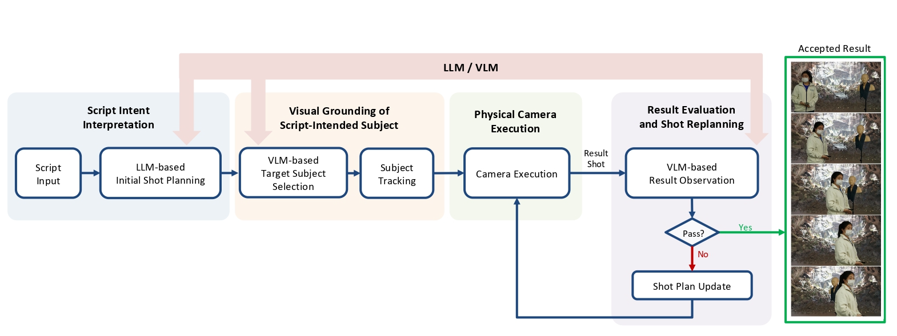

# Script-driven Autonomous Cinematography in Virtual Production using VLM

촬영 대상 탐지, 선택, 추적 → Edelkrone 카메라 로봇 제어 → 영상 녹화 → VLM 촬영 결과 평가 및 재계획 

으로 이루어진 버추얼프로덕션에서의 시각언어모델을 이용한 각본 기반 촬영 자동화 시스템입니다.

## Pipeline



**main 파일:** `main_obs_recording.py`

초기 Shot Plan을 기반으로 촬영을 수행하고, 촬영 결과에 따라 `subject` 또는 `camera_movement`를 수정하는 재계획 루프를 실행합니다.

## 1. 피사체 검출 및 추적

YOLO로 프레임의 객체를 검출하고 DeepSORT로 Track ID를 유지합니다. 선택된 피사체의 Bounding Box를 이용하여 화면 중심과의 위치 오차를 계산합니다.

**`main_obs_recording.py`**

```python
frame_center_x = frame_width // 2
frame_center_y = frame_height // 2
main_center_x = (main_x1 + main_x2) // 2
main_center_y = (main_y1 + main_y2) // 2
dx = main_center_x - frame_center_x
dy = main_center_y - frame_center_y
```

`gpt_detectmaincharacter.py`는 추적 ID가 표시된 영상과 촬영 대상 설명을 VLM에 전달하여 목표 Track ID를 선택합니다.

## 2. Edelkrone 로봇 카메라 제어

Python에서 Edelkrone 로컬 HTTP API(`127.0.0.1:32222/v1`)로 JSON 제어 명령을 전송했습니다. 촬영 실행 중 추적 오차와 Shot Plan에 따라 이동 속도를 계산하고, 약 30Hz 간격으로 제어 명령을 전달하도록 작성했습니다.

### Shot Plan에 따른 이동 명령

**`main_obs_recording.py`**

```python
pan_speed = 0.0
slide_speed = 0.0
tilt_speed = 0.0
if result["status"] == "FOUND":
    if shot_plan["camera_movement"] == "static":
        pass
    elif shot_plan["camera_movement"] == "truck_left":
        slide_speed = -0.2
    elif shot_plan["camera_movement"] == "truck_right":
        slide_speed = 0.2
    elif shot_plan["camera_movement"] == "track":
        if abs(dx) > 150:
            direction_x = np.sign(dx)
            slide_speed = 0.2 * direction_x
            pan_speed = 0.25 * direction_x
```

- **Static:** 이동 속도 0 유지
- **Truck Left / Right:** Slider에 지정 방향의 속도 명령 생성
- **Track:** 피사체 중심의 수평 오차가 임계값을 넘으면 이동 방향과 속도 계산

`main_obs_recording.py`에서 계산한 Pan과 Slide 속도를 각각 Head와 Slider 제어 함수에 전달합니다.

### HTTP API로 이동 명령 전송

**`camera_control/joystick_control.py`**

```python
def joystickMoveSlide(linkID, slideSpeed):
    url = f"http://127.0.0.1:32222/v1/bundle/{linkID}"
    headers = {"Content-Type": "application/json"}
    payload = {
        "command": "joystickMove",
        "slide": slideSpeed
    }
    try:
        requests.post(url, headers=headers, json=payload, timeout=0.1)
    except Exception as e:
        print(f"[joystickMoveSlide] 전송 실패: {e}")
```

`main_obs_recording.py`는 계산된 `pan_speed`와 `slide_speed`를 각 제어 함수에 전달하며, 촬영 루프 종료 시 두 장비에 속도 0 명령을 전송합니다.

**장비 제어 상세:** [`camera_control/`](camera_control/)에는 Pairing, Joystick 기반 Pan/Tilt/Slide, Keypose, Focus 제어 코드가 포함되어 있습니다.

**실제 장비 테스트 영상**

- [Pairing, Slider 및 Head 동작 테스트](https://youtu.be/ymi7L_NGuHY)
- [Focus 동작 테스트](https://youtu.be/3f1UxRr9e_w)

## 3. 촬영 영상 기록

`main_obs_recording.py`에서 OBS WebSocket으로 녹화를 시작하고 종료합니다. 동시에 YOLO/DeepSORT 시각화 영상을 별도로 저장하고 `trajectory_log.csv`에 피사체 위치, 프레임 중심 오차, 이동 명령 등을 기록합니다.

## 4. 촬영 결과 평가 및 재계획

녹화 영상에서 프레임을 추출하고 VLM으로 장면을 설명한 뒤 Visibility, Framing, Narrative Emphasis, Camera Movement 기준으로 결과를 평가합니다. 평가 결과를 바탕으로 Shot Plan을 수정하여 다시 촬영합니다.

**`main_obs_recording.py`**

```python
result_evaluation = erq.video_qa(
    script, shot_plan, scene_description, log_evidence, base64Frames
)
revised_shot_plan = rsq.generate_revised_shot_plan(
    script, shot_plan, scene_description,
    result_evaluation, attempt_history, attempt_idx
)
```

최대 5회 시도하며, 평가 기준을 만족하면 반복을 종료합니다.

## 5. 주요 코드

| 파일 | 구현 내용 |
| --- | --- |
| `main_obs_recording.py` | 주 실행: 영상 입력, 추적, 이동 명령, OBS 녹화, 평가 및 재계획 |
| `gpt_detectmaincharacter.py` | VLM 기반 촬영 대상 Track ID 선택 |
| `yolo_deepsort.py`, `yolo_deepsort_gpt.py` | 객체 검출 및 추적 관련 코드 |
| `camera_control/joystick_control.py` | Edelkrone HTTP API 이동 명령 함수 |
| `camera_control/` | Pairing, Joystick, Keypose, Focus 등 장비 제어 코드 |
| `describe_scene_qa.py` | 촬영 장면 설명 |
| `evaluate_result_qa.py` | 촬영 결과 평가 |
| `replan_shot_qa.py` | Shot Plan 재계획 |
| `analyze_log.py` | 추적 로그 분석 |
| `QAprompt/`, `Script/` | 평가 프롬프트 및 촬영 각본 |

## 6. 실행 환경

Python, OpenCV, Ultralytics YOLO, DeepSORT, OpenAI API, OBS WebSocket, Edelkrone Local HTTP API를 사용합니다. OBS, FFmpeg 및 실제 장비 연결이 필요합니다.

```bash
pip install -r requirements.txt
```

### 환경변수 설정 (`.env`)

프로젝트 루트에 `.env` 파일을 직접 만들고 다음 값을 입력합니다.

```dotenv
OPENAI_API_KEY=your_openai_api_key
OBS_PASSWORD=your_obs_websocket_password
EDELKRONE_LINK_ID=your_edelkrone_link_id
```

| 변수 | 용도 |
| --- | --- |
| `OPENAI_API_KEY` | VLM 호출에 사용하는 OpenAI API 키 |
| `OBS_PASSWORD` | OBS WebSocket 연결 비밀번호 |
| `EDELKRONE_LINK_ID` | 페어링된 Edelkrone 장비 Bundle의 Link ID |

`python-dotenv`의 `load_dotenv()`로 `.env`를 불러옵니다.


## 7. 실험 결과 및 논문

| 시나리오 | 실험 내용 |
| --- | --- |
| Script 1 | Dolly In 촬영 |
| Script 2 | 이동 피사체 추적 |
| Script 3 | 평가 결과에 따른 재계획 및 재촬영 |

논문에서 Script 3의 Target-in-frame ratio는 **0.63 → 1.00**, Mean center error는 **0.58 → 0.34**로 개선되었습니다.

Jimin Han, Young J. Kim, *Script-driven Autonomous Cinematography in Virtual Production using Vision Language Models*, Korea Computer Graphics Society, 32(3), 121–131, 2026. [DOI](https://doi.org/10.15701/kcgs.2026.32.3.121)
